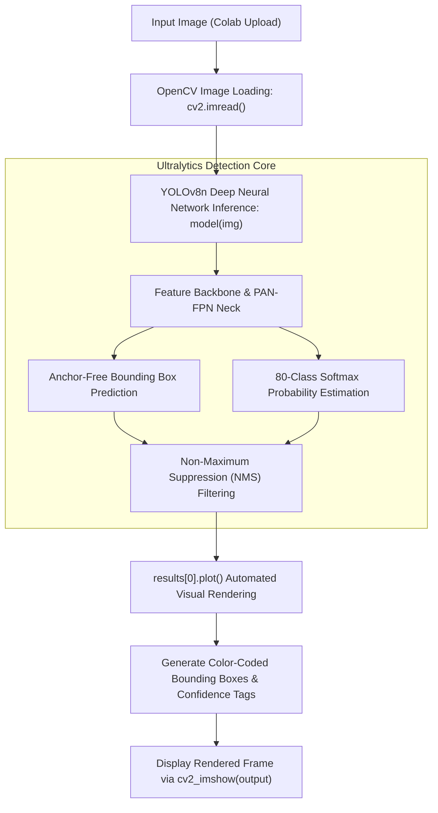

<h1 align="center">Object-detectionCV</h1>

<p align="center">
  <a href="https://colab.research.google.com/github/dipzz0/Object-detectionCV/blob/main/Object-detection.py" target="_blank"></a>
  
  
  
  
</p>

---

## ⚡ Overview

**Object-detectionCV** is an end-to-end, real-time multi-category object detection pipeline powered by **Ultralytics YOLOv8**.

Trained on the 80 common object classes of the Microsoft Common Objects in Context (MS COCO) dataset, this application detects, classifies, and annotates multiple simultaneous objects—including vehicles, pedestrians, animals, furniture, and electronic devices—in a single forward pass.

---

## 🚀 Key Features

- **🧠 State-of-the-Art Architecture:** Utilizes Ultralytics YOLOv8 Nano (`yolov8n.pt`) with an anchor-free split head for faster inference and superior accuracy.
- **🌐 80 MS COCO Object Classes:** Recognizes a vast spectrum of everyday objects (cars, persons, dogs, traffic lights, laptops, cell phones, etc.).
- **🎨 Built-in Color-Coded Annotation:** Employs `results[0].plot()` for automated, high-precision bounding boxes with unique per-class color coding and confidence percentages.
- **⚡ Ultra-Low Latency:** High-speed inference (~12ms on GPU) suitable for robotics, drone perception, and security feeds.
- **☁️ 1-Click Google Colab Workflow:** Interactive file uploader with OpenCV rendering using `cv2_imshow()`.

---

## 🎮 Workflow & Detection Pipeline



---

## 🏷️ Supported Object Categories (MS COCO)

YOLOv8 can identify all 80 classes across major categories:

| Category | Typical Detected Classes |
| :--- | :--- |
| **People & Accessories** | `person`, `backpack`, `umbrella`, `handbag`, `tie`, `suitcase` |
| **Vehicles & Transport** | `bicycle`, `car`, `motorcycle`, `airplane`, `bus`, `train`, `truck`, `boat` |
| **Traffic & Outdoor** | `traffic light`, `fire hydrant`, `stop sign`, `parking meter`, `bench` |
| **Animals** | `bird`, `cat`, `dog`, `horse`, `sheep`, `cow`, `elephant`, `bear`, `zebra`, `giraffe` |
| **Electronics & Office** | `tv`, `laptop`, `mouse`, `remote`, `keyboard`, `cell phone`, `book`, `clock` |
| **Food & Dining** | `bottle`, `wine glass`, `cup`, `fork`, `knife`, `spoon`, `bowl`, `banana`, `apple`, `pizza` |

---

## 💻 How to Run in Google Colab

1. **Launch in Colab:**  
   Click the **"Open In Colab"** badge above or open in [Google Colab](https://colab.research.google.com).

2. **Execute Cell:**  
   The script automatically installs `ultralytics` and downloads the lightweight `yolov8n.pt` weights.

3. **Upload an Image:**  
   Upload any scene containing one or many objects (street, office, park, living room).

4. **Instant Annotation:**  
   YOLOv8 annotates every detected object with distinct color-coded bounding boxes, class names, and confidence scores.

---

## 🌐 Running Locally

To run the project on your local machine:

1. **Clone the repository:**
   ```bash
   git clone https://github.com/dipzz0/Object-detectionCV.git
   cd Object-detectionCV
   ```

2. **Install dependencies:**
   ```bash
   pip install ultralytics opencv-python
   ```

3. **Run the script:**
   ```bash
   python Object-detection.py
   ```
   *(Note: Replace `cv2_imshow(output)` with `cv2.imshow('Detections', output)` and `cv2.waitKey(0)` when running locally).*

---

## 🛠️ Technology Stack

| Technology | Purpose | Description |
| :--- | :--- | :--- |
| **Ultralytics YOLOv8** | Model & Inference | Real-time object detection and segmentation framework |
| **PyTorch** | Deep Learning Backend | PyTorch-powered tensor compute engine |
| **OpenCV** | Vision & Display | Image I/O and display pipeline |
| **MS COCO** | Training Benchmark | Standard dataset with 80 annotated categories |
| **Google Colab** | Execution Environment | Cloud GPU/CPU serverless platform |

---

## 📄 License

This repository is distributed under the [MIT License](LICENSE).

---

<p align="center">
  <b>Developed with ❤️ by <a href="https://github.com/dipzz0">dipzz0</a></b>
</p>
